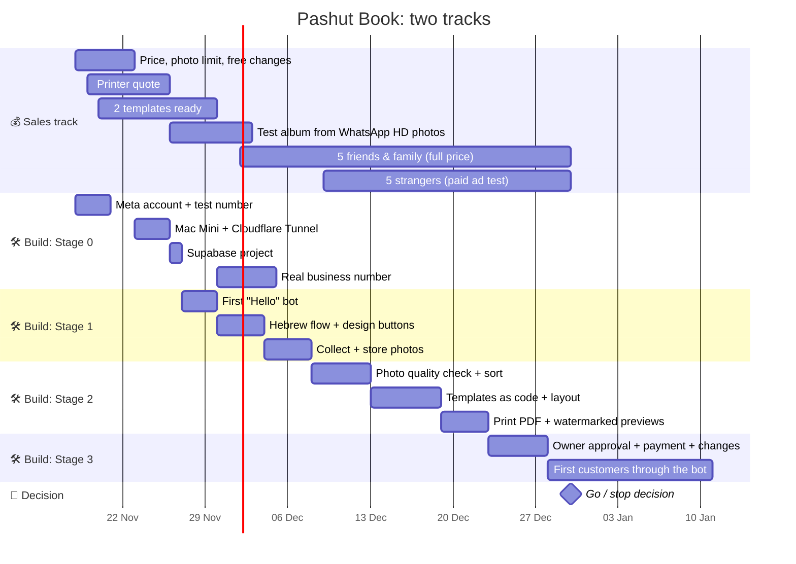

# Pashut Book: Roadmap

Start date: **November 18, 2026 (week 1)**.

Two tracks run **in parallel**:
- 🛠️ **Build track:** the WhatsApp bot. It's also a learning goal.
- 💰 **Sales track:** real paying customers. **It does not wait for the bot.** If the bot isn't ready, albums are made by hand.

**Fixed date: first paying strangers by [DATE].** (Not set yet.)

**Who does each task:**
- 🙋 **You:** things only you can do (accounts, phone calls, decisions, payments)
- 🤝 **Together:** we build it in a chat (you run things, I write the code and explain)

**Rule:** one task (or a small group of tasks) per new chat. When a task is done, mark it ✅ here.

---

## Timeline (Gantt)

The dates for weeks 3–6 are a plan until the fixed date is set.

---

## 💰 Sales track (from week 1)

| # | Task | Who | When | Done when… |
|---|---|---|---|---|
| S.1 | Decide the **price, photo limit** (50 or 100), and **free changes** per album. Use the [ROI calculator (Google Sheet)](https://docs.google.com/spreadsheets/d/1ZCKRQZeCI5KIRq7gG5fmPfoNe2K_A7gINmlTygY1NUw/edit). | 🙋 + 🤝 | Week 1 | Decisions written in README.md |
| S.2 | **Printer quote:** call or email 3 local printers about price, sizes, paper, PDF specifications, delivery time, and shipping | 🙋 | Weeks 1–2 | One printer chosen, with their file specifications |
| S.3 | **2 templates ready** (Classic / Colorful) in the printer's page size. Used by hand now; the bot will copy the same look later. | 🙋 + 🤝 | Weeks 1–2 | Sample pages look good |
| S.4 | **Test album** printed from **WhatsApp HD photos**, including some full-page photos | 🙋 | Weeks 1–2 | You know whether HD photos print well enough at full-page size |
| S.5 | **Set the fixed date** for the first paying strangers, and replace [DATE] in README.md and here | 🙋 | Week 2 | The date is written down |
| S.6 | **Tracking sheet:** for every album, owner minutes spent, number of revision requests, price paid, and how the customer found us | 🤝 | Week 2 | The sheet is ready before the first album |
| S.7 | **5 albums for friends and family at FULL price** | 🙋 | Weeks 3–6 | 5 delivered and tracked |
| S.8 | **5 albums for strangers** from a small paid ad test. *The ad plan will be made from scratch in a separate session.* | 🙋 | Weeks 3–6 | 5 delivered and tracked |

---

## 🛠️ Build track

### Stage 0: Preparation

| # | Task | Who | Done when… |
|---|---|---|---|
| 0.1 | Meta for Developers account, a Business app with WhatsApp, and the **free test number** (it can message only **up to 5 pre-registered numbers**). Guide: [docs/setup/0.1-meta-whatsapp.md](docs/setup/0.1-meta-whatsapp.md) | 🙋 + 🤝 | Your phone gets the "Hello World" test message from the test number, and you reply "Hi" (seeing incoming messages needs the webhook, in 1.1) |
| 0.2 | **Mac Mini setup:** Python, never sleep, auto-restart after a power cut, Cloudflare Tunnel | 🤝 | A test page on the Mac opens from your phone on mobile data |
| 0.3 | Free **Supabase** project | 🤝 | The project exists and its keys are saved safely in `.env` |
| 0.4 | **Real business number** on the WhatsApp Business Platform (for example a virtual 07x number) | 🙋 + 🤝 | Any phone, not just the 5 test numbers, can message the bot |

The printer and the test album are in the sales track (S.2, S.4).

### Stage 1: Basic bot

| # | Task | Who | Done when… |
|---|---|---|---|
| 1.1 | **First bot:** the Mac receives WhatsApp messages and answers "Hello!" | 🤝 | You write to the bot and get an automatic reply |
| 1.2 | **Hebrew conversation + design buttons:** welcome → choose design → HD instructions → send photos → cover title | 🤝 | You can walk through the whole conversation |
| 1.3 | **Collect and store photos:** save each one in Supabase, count them, enforce the limit | 🤝 | 60 photos sent → "Got 60 photos 👍", all saved |

### Stage 2: Automatic album

| # | Task | Who | Done when… |
|---|---|---|---|
| 2.1 | **Quality check:** blurry photos, duplicates, image size, sort by date | 🤝 | Bad photos in a test folder are flagged |
| 2.2 | **Layout:** turn the 2 templates (S.3) into code and fill them automatically. Low-quality photos only in small spots. | 🤝 | A full album is created with no human help |
| 2.3 | **Print PDF** in the printer's exact specifications | 🤝 | The printer accepts the file |
| 2.4 | **Watermarked previews:** small, numbered page images sent in WhatsApp | 🤝 | You get the page images in WhatsApp |

### Stage 3: First customers through the bot

| # | Task | Who | Done when… |
|---|---|---|---|
| 3.1 | **Owner approval** on your WhatsApp ("Approve / Problem") | 🤝 | Your approval moves the order forward |
| 3.2 | **Payment** (Bit request by hand), **limited changes** (made by hand), **shipping address** | 🤝 | A full order runs from start to finish |
| 3.3 | **Photo cleanup:** delete photos automatically after delivery | 🤝 | Old test photos disappear by themselves |
| 3.4 | **First customers served through the bot** | 🙋 | At least one sales-track album went through the bot |

### Stage 4: Polish and grow (🔒 only after the go/stop decision passes)

A payment company, automatic changes, order tracking, more languages (each with its own campaign), a Lupa option, and a cloud server at around 30–50 albums a month.

---

## 🚦 Go / stop decision (after the 10 albums, before Stage 4)

The criteria are set **now**, not after the test. Continue only if **all** of them pass:

- [ ] At least **5 strangers** paid
- [ ] Cost per paying customer from ads: **at most half of profit per album** — about ₪42 at current estimates. Recalculate after the printer quote and final price are set.
  (Profit per album = price − printing − payment fees − packaging and other small costs. See the rule under "Marketing and sales" in README.md.)
- [ ] Owner time per album: **30 minutes or less**
- [ ] At least **1 referral or repeat order**

If not: change **one** thing (price, offer, or audience) and rerun the test once, or stop the business side. The bot stays as a learning project.

---

## Postponed (on purpose)

- **Business registration (עוסק פטור):** the owner will handle it later. It's needed before a payment company is added (Stage 4).
- **Ad strategy:** will be planned from scratch in a separate session.

## Key dependencies (what must come first)

- **0.1 Meta account** → all of Stage 1
- **S.2 Printer chosen** → S.3 templates (page size) → 2.2 layout → 2.3 print PDF
- **S.4 Test album** → whether full-page photos are allowed
- **0.4 Business number** → 3.4 customers through the bot (the test number reaches only 5 numbers)
- **Go / stop decision** → Stage 4
