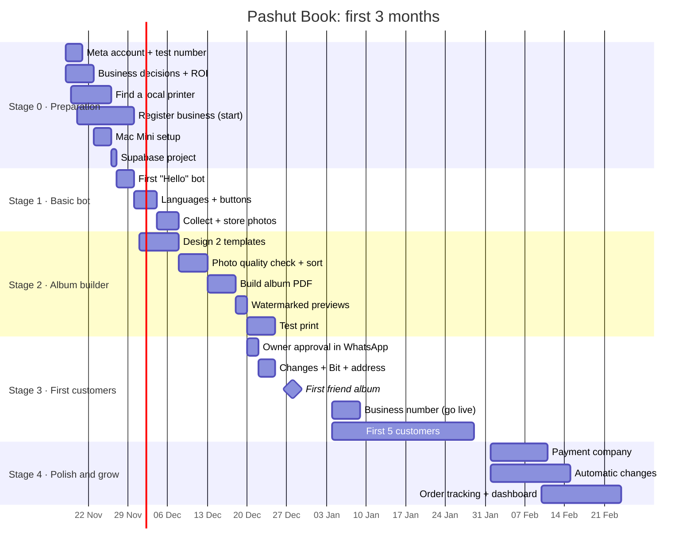

# Pashut Book: Roadmap

Start date: **November 18, 2026**. Goal: **the first friends-and-family album printed by the end of December 2026.**

**Who does each task:**
- 🙋 **You:** things only you can do (accounts, phone calls, decisions, payments)
- 🤝 **Together:** we build it in a chat (you run things, I write the code and explain)

**Rule:** one task (or a small group of tasks) per new chat. When a task is done, mark it ✅ here.

---

## Timeline (Gantt)

---

## Stage 0: Preparation (Nov 18 – Nov 30)

| # | Task | Who | Time | Done when… |
|---|---|---|---|---|
| 0.1 | Create a Meta for Developers account, a Business app, and add WhatsApp to get the **free test number** | 🙋 + 🤝 | 1–2 h | You send "Hi" from your phone and see it arrive in Meta's dashboard |
| 0.2 | **ROI calculator:** price, printing cost, hours per album, profit per month | 🤝 | 1 h | You have a spreadsheet and a first price |
| 0.3 | Decide: **photo limit** (50 or 100), **free changes** per album, **price** | 🙋 | 30 min | Decisions written in README.md |
| 0.4 | Call or email **3 local printers**: price, album sizes, paper, file format (PDF specs), delivery time, do they ship? | 🙋 | 2–4 h | You chose one printer and have their file specifications |
| 0.5 | Start registering an **עוסק פטור** (tax authority + national insurance) | 🙋 | 1–2 h + waiting | Registration submitted |
| 0.6 | **Mac Mini setup:** install Python, never sleep, auto-restart after a power cut, Cloudflare Tunnel | 🤝 | 2 h | A test page on the Mac opens from your phone on mobile data |
| 0.7 | Create a free **Supabase** project | 🤝 | 30 min | The project exists and its keys are saved safely in `.env` |

## Stage 1: Basic bot (Nov 26 – Dec 10)

| # | Task | Who | Time | Done when… |
|---|---|---|---|---|
| 1.1 | **First bot:** the Mac receives WhatsApp messages and answers "Hello!" | 🤝 | 2–3 h | You write to the test number and get an automatic reply |
| 1.2 | **Languages:** detect Hebrew, English, Russian, Arabic and answer in the same one (Claude) | 🤝 | 2–3 h | A friend writes in Russian and gets an answer in Russian |
| 1.3 | **Conversation flow + buttons:** welcome → choose design → HD instructions → send photos → cover title | 🤝 | 3–4 h | You can walk through the whole conversation |
| 1.4 | **Collect photos:** download each photo, save it in Supabase, count it, enforce the limit | 🤝 | 3–4 h | 60 photos sent → "Got 60 photos 👍", all saved |

## Stage 2: Album builder (Dec 1 – Dec 24)

| # | Task | Who | Time | Done when… |
|---|---|---|---|---|
| 2.1 | **Design 2 templates** (Classic / Colorful) in the printer's exact page size, with right-to-left text support | 🙋 + 🤝 | 4–6 h | Sample pages look good on screen |
| 2.2 | **Quality check:** measure each photo's quality, detect blurry photos and duplicates, sort by date | 🤝 | 3–4 h | A test folder is sorted correctly and bad photos are flagged |
| 2.3 | **Layout:** fill the templates automatically (low-quality photos only in small spots, AI helps pick the cover) | 🤝 | 4–6 h | A full album is created with no human help |
| 2.4 | **Print PDF:** exact size, high quality, the printer's specifications | 🤝 | 2–3 h | The printer accepts the file |
| 2.5 | **Previews:** small page images with a "PREVIEW" watermark, numbered, sent in WhatsApp | 🤝 | 2 h | You get the page images in WhatsApp |
| 2.6 | **Test print:** print one automatic album and check colors, cutting, and text | 🙋 | ~5 days (waiting) | The printed album looks good in your hands |

## Stage 3: First customers (Dec 20 – Jan 31)

| # | Task | Who | Time | Done when… |
|---|---|---|---|---|
| 3.1 | **Owner approval:** finished albums go to your WhatsApp with "Approve / Problem" buttons | 🤝 | 2 h | Your approval moves the order forward |
| 3.2 | **Changes, payment, address:** the customer asks for changes (you make them by hand), you send a Bit request by hand, the bot collects the address | 🤝 | 3 h | A full order runs from start to finish |
| 3.3 | 🎯 **First friend album** (end of December) | 🙋 | | A friend holds their album |
| 3.4 | **Business number:** buy a virtual 07x number and move the bot from the test number to it | 🙋 + 🤝 | 1–2 h | Anyone can message the bot |
| 3.5 | **Photo cleanup + privacy:** delete photos automatically after delivery | 🤝 | 1–2 h | Old test photos disappear by themselves |
| 3.6 | **First 5 real customers.** Write down everything that goes wrong. | 🙋 | January | 5 albums delivered + a list of lessons |

## Stage 4: Polish and grow (February 2027 →)

Decide the order based on what you learned in Stage 3:
- **Payment company** (Grow / PayPlus / Cardcom) for automatic Bit and card links
- **Automatic changes** for the most common requests
- **Order tracking** ("Where is my album?") and an owner dashboard
- **Marketing:** flyers, a QR code, and Facebook parenting groups
- **Lupa option**, and a move to a **cloud server** at around 30–50 albums a month

---

## Key dependencies (what must come first)

- **0.1 Meta account** → everything in Stage 1
- **0.4 Printer chosen** → 2.1 templates (page size) → 2.4 print PDF
- **0.5 Business registered** → 3.4 business number and the Stage 4 payment company
- **2.6 Test print approved** → 3.3 first friend album
