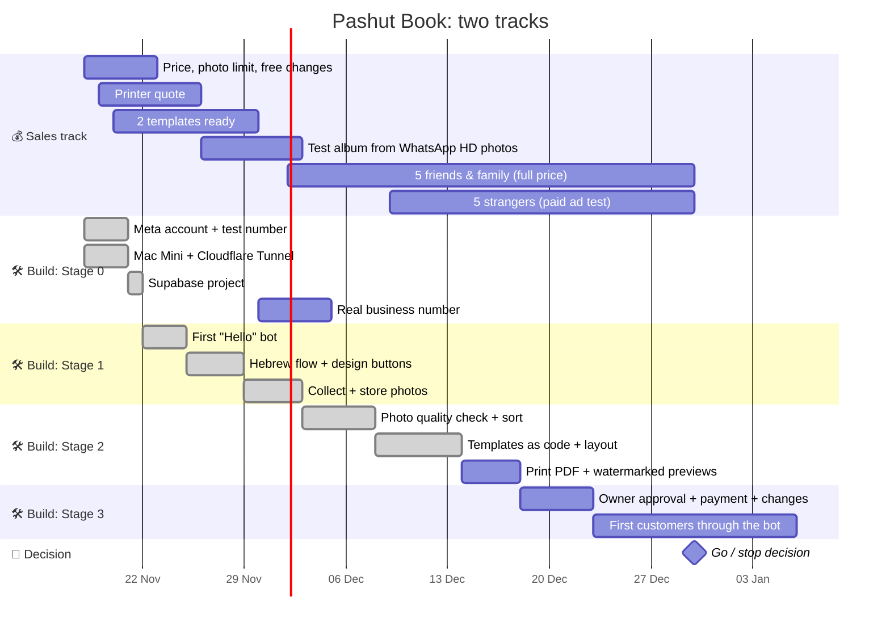

# Pashut Book: Roadmap

Start date: **November 18, 2026 (week 1)**.

Two tracks run **in parallel**:
- 🛠️ **Build track:** the WhatsApp bot. It's also a learning goal.
- 💰 **Sales track:** real paying customers. **It does not wait for the bot.** If the bot isn't ready, albums are made by hand.

**Fixed date: first paying strangers by [DATE].** (Not set yet.)

**Who does each task:**
- 🙋 **You:** things only you can do (accounts, phone calls, decisions, payments)
- 🤝 **Together:** we build it in a chat (you run things, I write the code and explain)

**Rule:** one task (or a small group of tasks) per new chat. When a task is done, mark it ✅ here.

---

## Timeline (Gantt)

The dates for weeks 3–6 are a plan until the fixed date is set.

---

## 💰 Sales track (from week 1)

| # | Task | Who | When | Done when… |
|---|---|---|---|---|
| S.1 | Decide the **price, photo limit** (50 or 100), and **free changes** per album. Use the [ROI calculator (Google Sheet)](https://docs.google.com/spreadsheets/d/1ZCKRQZeCI5KIRq7gG5fmPfoNe2K_A7gINmlTygY1NUw/edit). | 🙋 + 🤝 | Week 1 | Decisions written in README.md |
| S.2 | **Printer quote:** call or email 3 local printers about price, sizes, paper, PDF specifications, delivery time, and shipping | 🙋 | Weeks 1–2 | One printer chosen, with their file specifications |
| S.3 | **2 templates ready** (Classic / Colorful) in the printer's page size. Used by hand now; the bot copies the same look (only `album/designs.py` changes). Also: (1) make the 2 designs **clearly different** (e.g. calm and elegant vs. bright and playful; the first versions felt too basic and too similar); (2) a **sample picture** of the same page in both designs, side by side, sent by the bot before the design buttons; (3) a **full example album** for each design on pashutbook.com (free hosting, e.g. Cloudflare Pages; free stock photos with a business licence, **never** family or customer photos), opened from a **link button** in the bot. The same pages can go on the landing page (needed for 0.4) and in ads. (4) **How the bot shows the choice** (owner's idea, Nov 24, 2026, inspired by a swipeable carousel message): send **one message per design**, each with a big example picture on top and its own button below ("✅ בוחרים קלאסי" / "✅ בוחרים צבעוני"), so the customer sees an example right above the button they tap; this replaces the single side-by-side picture in (2). A real WhatsApp carousel was checked and rejected: on the official API it exists only as a **marketing template** (Meta approval, paid per message even mid-conversation, and Meta may hold marketing messages back, so the design choice might not arrive). Reply buttons with an image header are free and always delivered. | 🙋 + 🤝 | Weeks 1–2 | Sample pages look good, and a customer can see both designs before choosing |
| S.4 | **Test album** printed from **WhatsApp HD photos**, including some full-page photos | 🙋 | Weeks 1–2 | You know whether HD photos print well enough at full-page size |
| S.5 | **Set the fixed date** for the first paying strangers, and replace [DATE] in README.md and here | 🙋 | Week 2 | The date is written down |
| S.6 | **Tracking sheet:** for every album, owner minutes spent, number of revision requests, price paid, and how the customer found us | 🤝 | Week 2 | The sheet is ready before the first album |
| S.7 | **5 albums for friends and family at FULL price** | 🙋 | Weeks 3–6 | 5 delivered and tracked |
| S.8 | **5 albums for strangers** from a small paid ad test. *The ad plan will be made from scratch in a separate session.* | 🙋 | Weeks 3–6 | 5 delivered and tracked |

### Shipping and quality check: two phases

The owner approves every album **on screen** before printing (the design). The two phases cover the **printed book**:

1. **The first ~10 albums (S.7 and S.8):** the printer sends each book **to the owner** (or the owner picks it up). The owner checks it (colors, cutting, dark photos, binding), then ships it or hands it over. Goal: learn what printing problems look like, and make sure no customer gets a bad book. Log the extra minutes in the tracking sheet (S.6).
2. **After that:** the printer ships **straight to the customer**. The owner still approves every album on screen, and picks up a sample book now and then (or asks the printer for a phone photo of the finished book).

This applies to any printer: local, or Prodigi.

---

## 🛠️ Build track

### Stage 0: Preparation

| # | Task | Who | Done when… |
|---|---|---|---|
| 0.1 ✅ | Meta for Developers account, a Business app with WhatsApp, and the **free test number** (it can message only **up to 5 pre-registered numbers**). Guide: [docs/setup/0.1-meta-whatsapp.md](docs/setup/0.1-meta-whatsapp.md) | 🙋 + 🤝 | Your phone gets the test message from the test number. ✅ Done with a workaround: the **testing** app lives under the owner's older portfolio, which Meta doesn't restrict. The new Pashut Book portfolio can't send until it's verified (see 0.4) |
| 0.2 ✅ | **Mac Mini setup:** Python, never sleep, auto-restart after a power cut, Cloudflare Tunnel. Guide: [docs/setup/0.2-mac-mini-tunnel.md](docs/setup/0.2-mac-mini-tunnel.md) | 🤝 | A test page on the Mac opens from your phone on mobile data. ✅ Done: https://hello.pashutbook.com works on 5G and after a restart |
| 0.3 ✅ | Free **Supabase** project. Guide: [docs/setup/0.3-supabase.md](docs/setup/0.3-supabase.md) | 🤝 | The project exists and its keys are saved safely in `.env`. ✅ Done: project `pashut-book` (Frankfurt), secret key in `.env` on the Mac, connection test answered 200 (Nov 21, 2026) |
| 0.4 | **Real business number** on the WhatsApp Business Platform (for example a virtual 07x number) | 🙋 + 🤝 | **Pashut Book portfolio passes Meta Business Verification** (needs an official business document, e.g. עוסק פטור, ideally with the name "Pashut Book"), and any phone, not just the 5 test numbers, can message the bot |

The printer and the test album are in the sales track (S.2, S.4).

### Stage 1: Basic bot

| # | Task | Who | Done when… |
|---|---|---|---|
| 1.1 ✅ | **First bot:** the Mac receives WhatsApp messages and answers "Hello!" Guide: [docs/setup/1.1-first-bot.md](docs/setup/1.1-first-bot.md) | 🤝 | You write to the bot and get an automatic reply. ✅ Done Nov 22, 2026: the test number answers automatically (the app had to be **published** first) |
| 1.2 ✅ | **Hebrew conversation + design buttons:** welcome → choose design → HD instructions → send photos → cover title. Guide: [docs/setup/1.2-conversation.md](docs/setup/1.2-conversation.md) | 🤝 | You can walk through the whole conversation. ✅ Done Nov 22, 2026: tested on the owner's phone |
| 1.2b ✅ | **Texts and buttons from users' feedback** (Nov 25, 2026): shorter welcome, "🔄 להתחיל מחדש", videos said in the photo count, why 40–100 photos, a practical cover tip, title examples, the HD question **with the photo count** (not after the summary), more facts on the album page. Guide: [docs/setup/1.2-conversation.md](docs/setup/1.2-conversation.md#task-12b-users-feedback-nov-25-2026) | 🤝 | The owner walks through the new texts on the phone |
| 1.3 ✅ | **Collect and store photos:** save each one in Supabase, count them, enforce the limit. Guide: [docs/setup/1.3-photos.md](docs/setup/1.3-photos.md) | 🤝 | 60 photos sent → "Got 60 photos 👍", all saved. ✅ Done Nov 22, 2026: 57 photos sent from the owner's phone, 57 counted, 57 saved in Supabase |

### Stage 2: Automatic album

| # | Task | Who | Done when… |
|---|---|---|---|
| 2.1 ✅ | **Quality check:** blurry photos, duplicates, image size, sort by date. Guide: [docs/setup/2.1-quality-check.md](docs/setup/2.1-quality-check.md) | 🤝 | Bad photos in a test folder are flagged. ✅ Done Nov 22, 2026: 16-photo test on the Mac; burst shots removed, blurry limits raised to 80/150 after the test |
| 2.2 ✅ | **Layout:** turn the 2 templates (S.3) into code and fill them automatically. Low-quality photos only in small spots. **Tell the customer about photo quality** in one short message, only when there's a problem (no per-photo table): e.g. "3 blurry and 2 repeated photos were left out"; if many photos came without HD (they arrive exactly 2048 px on the long side; with HD ~5000), ask them to resend with HD (buttons: [How do I send HD?] [Continue anyway]) before the album is built. Texts go in `server/texts/he.json`. Guide: [docs/setup/2.2-layout.md](docs/setup/2.2-layout.md) | 🤝 | A full album is created with no human help, and a customer with bad or non-HD photos gets the right short message. ✅ Done Nov 23, 2026: tested in 4 rounds on the owner's real album through the bot (faces never cut, fuller pages, 20% edge-to-edge pages, the customer chooses and can change the cover photo, HD question and left-out message work). The page size and look are still placeholders until S.2 and S.3 |
| 2.3 ✅ | **Print PDF** in the printer's exact specifications. Guide: [docs/setup/2.3-print-pdf.md](docs/setup/2.3-print-pdf.md) | 🤝 | The printer accepts the file. ✅ Built Nov 23, 2026: `print-pages.pdf` + `print-cover.pdf` at 300 DPI with 3 mm bleed and a resolution check. The printer's rules are placeholders in `album/printer.py` until S.2; the final test is the chosen printer accepting the file (and a wrap-around hardcover with a spine, if needed) |
| 2.4 ✅ | **Watermarked previews:** small, numbered page images sent in WhatsApp. Guide: [docs/setup/2.4-previews.md](docs/setup/2.4-previews.md) | 🤝 | You get the page images in WhatsApp. 🔧 Built Nov 23, 2026: one WhatsApp message with the cover and a button that opens a private page (random link, 30 days) with the whole album as small numbered spreads with a PREVIEW mark; then buttons [😍 אהבתי!] [✏️ לשנות משהו]. ✅ Tested Nov 23, 2026 on the owner's phone: the link arrived with the cover on top and the page opened well; the owner prefers the link to separate images. Fixed after the test: emojis in the cover title printed as an empty box, now removed |
| 2.5 ✅ | **Check the cover photo when it arrives** (agreed in task 2.3, after the owner's cover printed at only 146 DPI: a wide, non-HD photo cut to the square cover). (1) Right after the cover photo comes in, a short message so the customer knows it arrived, e.g. "קיבלנו את התמונה 👍 בודקים שהיא מתאימה לכריכה, זה ייקח כמה שניות…". (2) The bot waits for the photo to download and checks it: too small for the cover (under 150 DPI after cutting to the cover's shape) or blurry. (3) Good → the usual "beautiful photo" answer. Not good → one short message with buttons [📷 לשלוח תמונה אחרת] [להמשיך עם התמונה הזאת]; if it's a non-HD photo (exactly 2048 px), explain how to send in HD instead. (4) "Continue anyway" → the cover shows the photo smaller (not edge to edge) so it stays sharp, with a note for the owner. Texts in `server/texts/he.json` | 🤝 | A too-small or blurry cover photo gets the right message within seconds, and the customer is never left wondering whether the photo arrived. 🔧 Built Nov 23, 2026 (the owner's 2048×1152 case measures 146 DPI and is caught). ✅ Tested Nov 24, 2026 on the owner's phone. Changed after the test: ask for HD under 180 DPI (a normal photo without HD, 195, passes on purpose; 200 was too strict), a "doesn't fill the cover" message for screenshots and panoramas, shorter cover messages, and the cover photo is no longer repeated inside the album. Guide: [docs/setup/2.5-cover-check.md](docs/setup/2.5-cover-check.md) |

### Stage 3: First customers through the bot

| # | Task | Who | Done when… |
|---|---|---|---|
| 3.1 | **Owner approval** on your WhatsApp ("Approve / Problem"). Guide: [docs/setup/3.1-owner-approval.md](docs/setup/3.1-owner-approval.md) | 🤝 | Your approval moves the order forward. 🔧 Built Nov 24, 2026: after the customer's "😍 אהבתי!", the bot makes the print files and sends you the album link with [✅ לאשר] [⚠️ יש בעיה]; "approve" tells the customer it's ready for printing; "problem" lets you type a message that goes to the customer; the customer's replies come to you. Decided: you approve **before** payment. ✅ Tested Nov 25, 2026: the owner (own phone) and a customer (wife's phone) went through love it → request → problem message → customer got it. Changed after the test: the owner's report lists only real problems (under 150 DPI) and notes; photos at 150–199 DPI (e.g. every photo sent without HD, 195) are one summary line, not a list |
| 3.2 | **Payment** (Bit request by hand), **limited changes**, **shipping address**. Changes (owner's decision, Nov 25, 2026): (1) **a small number on every photo in the preview** (the photo's own number, the order it was sent in: never changes when the album is rebuilt, gaps where photos were left out; preview only, **never printed**), so the customer and their family can talk about "photo 15"; (2) **"📷 להחליף או להסיר תמונה"** in the "✏️ לשנות משהו" list: which number? → send a new photo (it goes into the same spot) or remove it → the album is built again. The owner's "problem" message can then point to a number; (3) **"עזרה" (help), a first small step** (moved here from task 1.2b, Nov 25, 2026): typing "עזרה" at any time → "write your question, we'll get back to you" → the customer's next message goes to the owner's phone with a "💬 לענות" button (the 3.1 setup, free). Limits (owner's decision): **text only** (photos never go to the owner), **one help message per customer per day** (a second one that day gets "we got your earlier message, we'll get back to you soon" and isn't passed on), cut at ~500 characters, and the owner chooses whether to answer. Later, a separate customer-service number takes these instead of the owner's private phone. The full "having trouble" menu comes only once real customers show the main problems | 🤝 | A full order runs from start to finish, and a customer can replace or remove one photo by its number 🔧 Built Nov 25, 2026 (not yet tested on a phone): numbers on every photo in the preview (not the cover; never printed); "📷 להחליף/להסיר תמונה" in the list (number → replace / remove / keep; a replaced photo takes the old one's exact spot and the other pages stay as they were; up to 10 changes, then the customer writes to the owner); after the owner's ✅: address in one message → [✅ נכון] [✏️ לתקן] → price (₪150 + ₪30 shipping, `PRICE`/`SHIPPING` in `.env`) → the owner gets the full number + address + [💰 התקבל תשלום] and sends the Bit request by hand → the customer hears it's going to print. After approval the customer can't change the album alone (their message goes to the owner). New Supabase columns `shipping_address`, `price`, `paid_at`, statuses `approved`/`paid` (`supabase/3.2-address-and-payment.sql`, run by hand). Also built Nov 25, 2026 after merging 1.2b: **"עזרה" (help)** as in point (3), and the photo-change steps use 1.2b's "↩️ בלי שינוי" button. Guide: [docs/setup/3.2-photo-changes-and-payment.md](docs/setup/3.2-photo-changes-and-payment.md) **Agreed after the build, Nov 25, 2026, and built the same day:** (1) a replaced photo that doesn't fit its spot well (it would be shown smaller with empty space) → only that page is laid out again, all other pages stay; (2) a tip in the "send the new photo" message: a photo the same way round (upright/sideways) fits best; (3) **limits on everything** (CLAUDE.md rule 11): 5 per album for each kind of change (photo changes 10 → 5, plus title, design, cover photo, adding photos, re-sending the cover), 3 new albums per phone per day, 3 messages to the owner per customer per day (CLAUDE.md rule 12: avoid sending customers to a human; after that an automatic "we got your messages"); at a limit, one polite message, without inviting the customer to write freely **After the owner's phone test, Nov 26, 2026 (built the same day):** (1) bigger, bold photo numbers (readable on a phone); (2) replacing or removing a photo shuffled the whole album: now it always starts from the album the customer saw (`layout.change_photos`): a replacement takes the old spot or re-lays only its page, a removal re-lays only its page (a page left empty goes, the next pages move up; a lone photo can't be removed below the minimum length, only replaced); (3) shipping details one question at a time (name → street → city → phone with "📱 המספר הזה"), each with a "✏️ לתקן" button right after it and a summary at the end; four Supabase columns (`supabase/3.2b-shipping-fields.sql`) ✅ Phone test Nov 26, 2026: bigger numbers readable, a replacement changed only its spot. Fixed the same day: photos arriving after the summary are counted quietly and announced once with the count, then the album is built once; no answer to late videos; "האלבום בהכנה" once per album |
| 3.3 ✅ | **Order history** (owner's goal, Nov 25, 2026: record as much data as possible, CLAUDE.md rule 10): a Supabase table with one row per moment of every order and its time: order started, photos received (count, with/without HD), HD question, album built (pages, photos used, left out and why), preview sent, each change, "love it", the owner's request (the report's numbers) and answer, and later paid, printed, delivered. Numbers only: no photos, no message texts. Download any table as CSV from Supabase; the tracking sheet (S.6) keeps what only the owner knows (minutes, price, where the customer came from) | 🤝 | Every step of a test order appears in the table with its time, and downloads as a CSV ✅ Built and tested on the Mac Nov 26, 2026: table `order_events` + views `order_history` (with seconds from the start / since the previous row) and `order_summary` (one row per order: photos, HD, pages, changes, minutes to the summary / link / "love it" / approval / payment); every new step and note of an order is recorded automatically, plus each photo saved, the cover check, the album check and build, the owner's request. Printed / sent / delivered come with the printing tasks. Guide: [docs/setup/3.3-order-history.md](docs/setup/3.3-order-history.md) |
| 3.3b | **Behaviour data** (owner's goal, Nov 26, 2026: understand how customers behave, find friction, and later build a dashboard; looked at the whole journey from a data-science angle). Record, numbers and codes only (never photos or texts): (1) **where the customer came from**: a source code in our wa.me links (a ready-made first message) and the ad details Meta attaches to click-to-WhatsApp ads (`referral`); (2) a **test mark** on orders from the owner's and family phones, so tests never mix with real customers; (3) **every incoming message**, also those that change nothing: kind (button / text / photo / video / other), the button tapped, whether the bot understood it, the text's length only; typing where a button was expected = a confusion signal; (4) **delivered / read** for each bot message (WhatsApp already sends these), with the message's name (e.g. `photos_count`), to see what customers read and how fast they answer; (5) **the album page**: opened or not, how many times, from how many devices, phone or computer, how far they scrolled; (6) **the bot's version** on every order, to compare before / after a change; (7) a **permanent anonymous customer key** (a scrambled phone number that can't be turned back) on every history row, so repeat customers can still be counted after task 3.4 deletes old orders; the privacy page gets one line about measuring how the service is used; (8) ready-made views: **funnel** (how many reach each step), **drop-off** (where unfinished orders stopped and how long ago), **friction** (confusion, help, HD resends, cover problems), **weekly trends**; (9) an **event dictionary** (`docs/data/events.md`): every event name and what it means. **Later, with the printing and delivery tasks:** facts about each photo (upright/wide, sharpness, faces, duplicate), the album's layout (layouts used, how much each photo was cut), printed / shipped / delivered, a 1-tap ⭐ 1–5 satisfaction question and "would you recommend us?" after delivery, reorders and recommendations, and the bot's own failures and slow builds. **The dashboard itself: not now** (owner's decision, Nov 26, 2026); later, on free tools (e.g. Looker Studio or Metabase) reading these views. Open questions for the task: where the first customers come from (ads, WhatsApp groups, friends, flyers), which decides the source codes; OK for the anonymous customer key (recommended). | 🤝 | Before 3.5: a test order shows its source, test mark, every message (with delivered/read), album page opens and the bot version, and the funnel view counts it |
| 3.4 🔧 | **Photo cleanup:** delete photos automatically after delivery, and **albums nobody paid for after some days (e.g. 14)**, so storage never fills up (CLAUDE.md rule 11) | 🤝 | Old test photos disappear by themselves. 🔧 Built Nov 26, 2026, tests pass, not yet run on the Mac: the bot deletes photos (Supabase + the album folder and links on the Mac) 14 days after an unpaid album's last message (the customer is told at their next message and starts fresh), 30 days after payment (no "delivered" step yet), and cancelled albums after an hour; `python3 server/cleanup.py` shows storage and what would go. Storage was 922 MB of 1 GB on Nov 26 (test albums). Guide: [docs/setup/3.4-photo-cleanup.md](docs/setup/3.4-photo-cleanup.md) |
| 3.5 | **First customers served through the bot** | 🙋 | At least one sales-track album went through the bot |

### Stage 4: Polish and grow (🔒 only after the go/stop decision passes)

A payment company, automatic changes, order tracking, more languages (each with its own campaign), a Lupa option, and a cloud server at around 30–50 albums a month.

**Future add-on: more products** (researched Nov 24, 2026, in the business model talk; not planned yet). The rule: the best next products reuse **the same customers and the same photos**, not just the process, because our hard-to-copy asset is the audience and the brand. Each was scored on real pain, same customers, reuse of what's built (bot, photo checks, layout engine), same supplier, and repeat sales.
1. **Family photo calendar: do first.** Same photos, bot, layout engine and printer (12 pages instead of 24). Strong season before Rosh Hashana (Israeli calendar makers work overtime then; family and baby photos are the favourite) and in January. Sold every year to past album customers, so almost no ad cost. Calendars are ~18% of photo product orders in one industry dataset.
2. **Kindergarten / class end-of-year album: biggest growth bet.** Real pain: today one volunteer parent collects photos from the class WhatsApp group and designs the album. The bot can collect photos from every parent and build it automatically. One order = ~25–35 copies (good printer prices), and 30 families meet the brand at once. Watch: season May–June, existing competitors (Lupa, studios, Albume), and privacy (other people's children: every parent must agree).
3. **Wall prints, magnets, photo tiles:** easy add-ons from the same photos (for example the cover photo for the wall).
4. **Event album from guests' photos** (bar/bat mitzvah, wedding, brit): real pain (photos scattered among guests), WhatsApp fits Israeli guests. Later.
5. **Memorial book:** real pain (choosing photos while grieving is hard), family sends photos and texts on WhatsApp. Only with a gentle, human tone; don't compete with free volunteer projects for bereaved families (e.g. "Album Or").
6. **Grandma's recipe book:** family sends recipes, handwritten pages and voice notes; AI types them up. Small, lovely niche.

Rejected: child-as-hero storybooks (crowded, different tech), family trip T-shirts (different supplier and business, size returns), name stickers (cheap and crowded), plain photo prints on WhatsApp (many Israeli labs already do it, which shows WhatsApp alone is not an advantage).
Order: albums first and pass the go/stop decision; then the calendar before the next Rosh Hashana; then the kindergarten album as the first big expansion.

**Wider ideas outside printing** (Nov 25, 2026; ideas only, the Israeli market not checked yet). The same recipe works wherever (1) ordering is hard or scary for the customer, (2) the raw input is already on their phone (photos, video, documents, voice notes), (3) a supplier is good at the work but doesn't want to sell or handle customers, and (4) automation can turn the messy input into a ready job that a person checks. Proof it works: virtual restaurant brands (MrBeast Burger: the brand did menu, ads and app, ~300 existing kitchens cooked at launch; quality varied by kitchen), AI moving quotes from a video of the rooms (Yembo, used by big US movers), Israeli tax refund firms (documents on WhatsApp, ~17–23% + VAT of the refund, only on success). Warning: SmileDirectClub (mail-order tooth aligners) shut down in 2023 after losses, ~$900M debt and lawsuits; in regulated fields the middle player takes the blame.
- **Home repairs for older people** (best fit): a photo or video of the problem on WhatsApp → a fixed price and a handyman. Same audience, real fear of being cheated. Risk: the work can only be checked after it's done.
- **Moving quotes:** film the flat on WhatsApp → one clear price from movers with empty days. Risk: big jobs, damage claims.
- **Custom furniture and closets:** photo + measurements → a ready spec for a carpentry workshop. Risk: measuring mistakes.
- **Certified document translation:** photo of a document → AI draft → a certified translator approves. Must be exact.
- **Getting your rights (מיצוי זכויות) for the elderly:** documents on WhatsApp → an expert handles it. Sensitive, regulated, existing players.
Lesson: products you can check before they're made (like albums) are safer than services. What carries over is the skill of winning and serving older customers on WhatsApp, not the code. Albums first.

Ideas from the owner's first album test (Nov 22, 2026), not planned yet:
- **Captions:** short headlines or notes next to some photos (for example, the customer types a caption after a photo they choose).
- **Logo on the HD video clip:** once Pashut Book has a logo, put it on the clip's title card (`server/media/hd-how-to-title-card.png`, the clip's first frame and WhatsApp preview picture; how it's made: guide 1.2). Owner's note, Nov 24, 2026.
- **HD video clip with wide margins** (users' feedback, Nov 25, 2026; postponed from task 1.2b): when the clip plays in WhatsApp on an iPhone and the screen is touched, the player's controls cover the top of the clip, exactly where the HD button is. Fix: shrink the clip and add a plain border around it, so the HD button sits in the middle of the screen. Done with ffmpeg, the same way the clip was made (guide 1.2).
- **A richer design:** the first designs felt very basic. To be decided with feedback from family and other users, in task S.3 (see S.3 for the sample picture and example albums).
- Letting customers rearrange photos themselves was considered and **rejected**: too hard in WhatsApp. They can ask for a simple change after the preview instead.

---

## 🚦 Go / stop decision (after the 10 albums, before Stage 4)

The criteria are set **now**, not after the test. Continue only if **all** of them pass:

- [ ] At least **5 strangers** paid
- [ ] Cost per paying customer from ads: **at most half of profit per album** — about ₪42 at current estimates. Recalculate after the printer quote and final price are set.
  (Profit per album = price − printing − payment fees − packaging and other small costs. See the rule under "Marketing and sales" in README.md.)
- [ ] Owner time per album: **30 minutes or less**
- [ ] At least **1 referral or repeat order**

If not: change **one** thing (price, offer, or audience) and rerun the test once, or stop the business side. The bot stays as a learning project.

---

## Postponed (on purpose)

- **Business registration (עוסק פטור):** the owner will handle it later. It's needed before a payment company is added (Stage 4).
- **Ad strategy:** will be planned from scratch in a separate session.

## Key dependencies (what must come first)

- **עוסק פטור registration** → Meta Business Verification of Pashut Book → 0.4 business number
- **0.1 Meta account** → all of Stage 1
- **S.2 Printer chosen** → S.3 templates (page size) → 2.2 layout → 2.3 print PDF
- **S.4 Test album** → whether full-page photos are allowed
- **0.4 Business number** → 3.5 customers through the bot (the test number reaches only 5 numbers)
- **3.3b Behaviour data** → 3.5 customers through the bot (the first real customers' data can't be recorded afterwards)
- **Go / stop decision** → Stage 4
